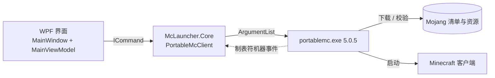

# MC Launcher

一个面向 Windows 的轻量级 **Minecraft: Java Edition** 启动器。界面用 WPF，登录、下载、校验和启动交给固定版本的 [PortableMC](https://github.com/theorzr/portablemc) 后端，不依赖 PCL、HMCL 或其他第三方启动器核心。


## 界面


左侧是账号、版本与内存设置，右侧是 PortableMC 的实时日志，底部是操作按钮与状态行。

新增「资源下载」标签页，可从 Modrinth、CurseForge 搜索并下载模组、整合包、光影包、资源包。

## 功能特性

| 功能 | 说明 |
| --- | --- |
| 微软正版登录 | 设备代码流：登录时自动复制验证码并打开微软验证页，成功后账号进入本地列表 |
| 离线账号 | 3–16 位字母、数字或下划线，启动时以离线身份进入游戏 |
| 版本列表 | 先扫描本地 `.minecraft/versions`，再合并 Mojang 正式版清单；下拉框可编辑，也能直接手输版本名 |
| 目录识别 | 可选 `.minecraft` 根目录、`versions` 目录或某一个具体版本目录；版本目录里存在 `mods/`、`saves/` 或 `options.txt` 时按隔离实例运行，使用自己的 `mods/config/saves` |
| 下载与修复 | 调用 PortableMC 的 `--dry` 校验，缺什么补什么，已完整的文件不会重复下载 |
| 资源下载 | Modrinth / CurseForge 双平台，支持模组、整合包、光影包、资源包，按关键词、Minecraft 版本与加载器筛选，分页浏览项目与文件 |
| 下载校验 | 显示字节进度，核对平台提供的 SHA-512 / SHA-1 与文件长度；取消或失败后删除临时文件，不覆盖同名文件 |
| Java 处理 | 优先用系统 Java，没有合适版本时自动下载 Mojang Runtime（`--jvm-policy system-then-mojang`） |
| 内存设置 | 1–32 GB 滑杆，直接映射为 `-Xmx` |
| 进度与日志 | 下载进度按文件数换算，界面最多保留最近 1000 行日志 |
| 随时取消 | 取消会结束整棵进程树，不会留下后台 Java 进程 |
| 设置持久化 | 目录、版本、内存、账号方式写入 `%LOCALAPPDATA%\McLauncher\settings.json`，下次启动自动恢复 |

## 快速开始

环境要求：Windows 10 1809 或更高版本，.NET 10 SDK（开发）或 .NET 10 Desktop Runtime（运行已构建的程序）。

```powershell
git clone https://github.com/baiji559/McLauncher.git
cd McLauncher
dotnet build McLauncher.slnx -c Release
dotnet run --project src\McLauncher.App\McLauncher.App.csproj
```

只想构建界面项目时可以直接指定项目，Core 会被自动带上：

```powershell
dotnet build src\McLauncher.App\McLauncher.App.csproj -c Release
```

运行核心冒烟测试（不依赖第三方测试框架）：

```powershell
dotnet run --project tests\McLauncher.Core.Tests\McLauncher.Core.Tests.csproj
```

正常情况下输出 14 行 `PASS`，包括双平台请求映射、中文名称搜索、版本分页、哈希校验、文件名安全、TLS 兼容重试、限流与取消清理测试。

下载界面绑定与布局测试（Windows；预览图输出到 `artifacts/`）：

```powershell
dotnet run --project tests\McLauncher.App.Tests\McLauncher.App.Tests.csproj
```

可选的真实 Modrinth 联网测试（四类资源搜索、版本列表，以及一个模组文件的下载和哈希校验；测试文件会自动清理）：

```powershell
dotnet run --project tests\McLauncher.Core.Tests\McLauncher.Core.Tests.csproj -- --live
```

针对中文名搜索的联网回归测试（苹果皮、锂、实体渲染机制优化，含 `1.20.1` / Fabric 文件列表）：

```powershell
dotnet run --project tests\McLauncher.Core.Tests\McLauncher.Core.Tests.csproj -- --live-search
```

可选的网络诊断，分别用系统代理和直连查询官方接口（至少一种连通才通过）：

```powershell
dotnet run --project tests\McLauncher.Core.Tests\McLauncher.Core.Tests.csproj -- --live-network
```

## 使用流程

1. **选择目录**：点「浏览…」选 `.minecraft` 根目录，或 `versions` 下的某个版本目录。默认目录是 `%LOCALAPPDATA%\McLauncher\game`。
2. **选择版本**：下拉框中本地版本排在前面，Mojang 正式版跟在后面；也可以直接输入版本名。
3. **选择账号**：默认微软正版，第一次需要点「登录」完成设备代码授权；也可以切到「离线」并填用户名。
4. **下载 / 修复**：第一次装某个版本先点这个按钮，等待进度条走完。之后文件缺失或被改动时同样用它修复。
5. **启动游戏**：按钮下方显示状态和 Java 选择结果，右侧日志给出 PortableMC 的完整输出。

> 微软认证缓存在资源目录下的 `portablemc_msa.json`，里面是会话令牌，不要提交到仓库或分享给别人。

## 资源下载

1. 在「启动与设置」中选择游戏目录和版本，再切换到「资源下载」。隔离实例会使用该实例自己的下载目录。
2. 选择 **Modrinth** 或 **CurseForge**，再选择模组、整合包、光影包或资源包。
3. 输入关键词、准确的 Minecraft 版本（例如 `1.20.1`），按需选择加载器。模组支持内置的常见中文名称和缩写，例如「苹果皮」「锂」「实体渲染机制优化」「JEI」；界面会显示实际使用的英文查询词。关键词和版本留空时不加该项限制，点击「搜索」可浏览热门资源。
4. 选择项目，点击「查看版本」，在文件列表中选择需要的版本，再点击「下载所选文件」。Beta / Alpha 文件会在名称旁标明。
5. 底部显示进度，可随时取消；「打开下载目录」可查看文件。下载目录分别为运行目录下的 `mods/`、`modpacks/`、`shaderpacks/`、`resourcepacks/`。

**CurseForge API Key**：官方 API 要求密钥，可到 [CurseForge for Studios](https://console.curseforge.com/) 申请，在下载页的密钥设置中填写，或启动前设置 `CURSEFORGE_API_KEY` 环境变量。密钥仅在当前进程中使用，不写入设置或日志，也不会发送给 Modrinth 或下载 CDN。Modrinth 无需密钥。

**下载范围**：模组需要对应的游戏版本、加载器和依赖；本功能不会自动安装这些依赖。光影包需要兼容的光影支持。整合包保留平台原始 `.mrpack` / `.zip` 文件，暂不自动导入实例或安装加载器。作者未开放直接下载的 CurseForge 文件会禁用下载按钮，可点击「打开文件网页」前往官方页面手动下载，不拼接 CDN 地址绕过限制。

**中文搜索**：两个平台使用同一份独立维护的名称索引 `src/McLauncher.Core/mod-search-names.json`，支持常见简繁中文名、缩写、唯一匹配的中文名称片段和复制的中英文名称。短名称（如「锂」「钠」）只做精确匹配，避免把无关关键词替换成模组名。索引随程序内嵌，无需额外联网获取；它并非 PCL 的完整数据库，未收录名称会保留原词查询并显示提示，可尝试英文名。修改此 JSON 并重新构建即可扩充索引。关键词搜索在 Modrinth 按相关性排序，CurseForge 使用平台默认排序；空关键词仍按下载量浏览。版本和加载器条件保持生效，两个平台的收录范围也可能不同。

**网络连接**：展开下载页的「网络设置 / CurseForge API Key」，默认跟随系统代理，取消勾选则直连；选项会保存到启动器设置，不改动 Windows 代理配置。临时连接错误和 HTTP 408 / 429 / 5xx 中的可重试状态最多尝试三次；TLS 握手失败后尝试 TLS 1.2 / HTTP 1.1。证书校验始终开启。权限错误和 404 不重试；较长的 `Retry-After` 交由用户稍后重试。日志显示失败域名、底层原因与重试次数，超时和用户取消分别提示。下载在建立连接阶段同样应用此策略，传输途中断开仍需重新下载，残留临时文件会清理。

## 项目结构

```text
McLauncher.slnx
├─ src/
│  ├─ McLauncher.Core/          PortableMC 适配层、双平台资源 API、流式下载与文件校验
│  └─ McLauncher.App/           WPF 界面：启动设置、日志与资源下载（MVVM）
├─ tests/
│  ├─ McLauncher.Core.Tests/    参数、事件、目录、平台 API 与下载完整性测试
│  └─ McLauncher.App.Tests/     下载界面绑定与布局测试
├─ tools/
│  └─ portablemc/               固定的 PortableMC 5.0.5 发行文件、LICENSE 与版本说明
├─ Directory.Build.props        统一开启 nullable、隐式 using，警告视为错误
└─ THIRD_PARTY_NOTICES.md       第三方组件版本、许可证与哈希
```

## 设计要点



- **UI 与后端解耦**：`McLauncher.Core` 不引用 WPF，`McLauncher.App` 只做界面与交互，换 UI 或换后端都只动一侧。
- **只认机器输出**：所有调用都带 `--output machine`，按制表符切分事件后映射到界面，不解析人类可读文本，避免日志格式变化导致崩溃。
- **同一时刻一个后端进程**：`PortableMcClient` 用信号量串行化调用，取消时连带结束子进程树。
- **线程模型**：可执行文件输出的每一行先进并发队列，再通过 `Dispatcher` 回到 UI 线程，长任务不阻塞界面。

## 已知限制

- 启动支持原版和已有的本地版本；模组依赖、加载器与整合包导入暂不自动安装。
- 没有启动器自动更新；资源下载暂不支持自动更新已安装的模组或管理依赖关系。
- CurseForge 搜索与版本列表需要用户提供有效的官方 API Key。
- 仅支持 Windows（WPF），界面只有中文。
- 微软登录使用设备代码，需要在浏览器里手动确认一次。

## 第三方组件

- **PortableMC 5.0.5**（Apache License 2.0，commit `99fdead`）：作为独立进程调用，未修改、未链接其源码。仓库内 `tools/portablemc/` 是上游官方 Windows x64 发行包的原样文件，许可证与 SHA-256 见 [THIRD_PARTY_NOTICES.md](THIRD_PARTY_NOTICES.md)。
- 选型过程与放弃的方案（Prism Launcher、Modrinth App、XMCL、ATLauncher、CmlLib.Core 等）记录在 [OPEN_SOURCE_RESEARCH.md](OPEN_SOURCE_RESEARCH.md)。

## 许可证

本仓库暂未附带开源许可证，默认保留所有权利。若要复用其中的代码，请先联系作者。

## 免责声明

本项目不是 Mojang Studios 或 Microsoft 的官方产品，与二者无关联，也不分发任何游戏本体或资源文件。使用前请自备 Minecraft 正版账号，并遵守 [Minecraft 最终用户许可协议](https://www.minecraft.net/eula)。

## English overview

MC Launcher is a small Minecraft: Java Edition launcher for Windows, written in C# with WPF on .NET 10. It delegates login, download, integrity verification and game launch to a pinned PortableMC 5.0.5 binary, and only consumes that binary's tab-separated `--output machine` events, so the UI layer and the launcher backend stay decoupled.

Highlights: Microsoft device-code login plus offline accounts, local and remote version lists, isolated-instance detection, download/repair, automatic Java detection with Mojang runtime fallback, configurable heap size, live progress and log, and cancellation that kills the whole process tree.

```powershell
dotnet build McLauncher.slnx -c Release
dotnet run --project src\McLauncher.App\McLauncher.App.csproj
```

No license is granted yet; all rights reserved.
