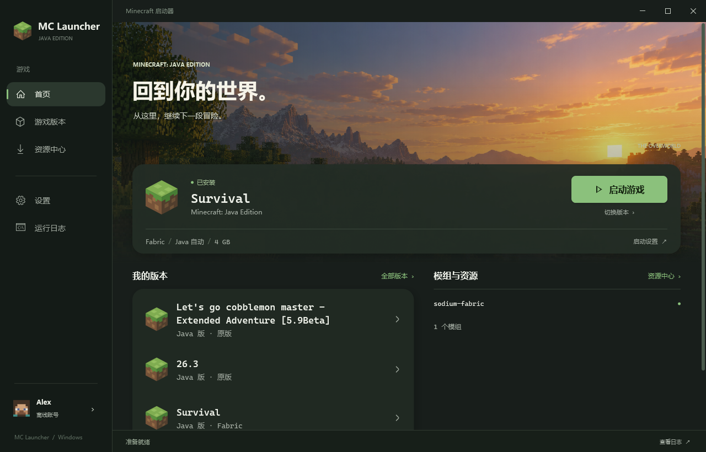

# MC Launcher

一个面向 Windows 的轻量级 **Minecraft: Java Edition** 启动器。使用 WPF 构建界面，通过固定版本的 [PortableMC](https://github.com/theorzr/portablemc) 处理登录、游戏文件下载、校验与启动，并提供 Modrinth 和 CurseForge 资源搜索与下载。




界面排版与优化版运行文件说明见 [UI-POLISH.md](docs/UI-POLISH.md)。

## 功能

- **游戏启动**：支持微软账号设备代码登录和离线账号，浏览本地版本与 Mojang 正式版，也可手动输入版本。
- **安装与修复**：通过 PortableMC 下载和校验游戏文件；自动检测系统 Java，需要时使用 Mojang Runtime。
- **游戏目录**：可选择 `.minecraft` 根目录或具体版本目录，识别已有的隔离实例。
- **资源下载**：搜索 Modrinth 和 CurseForge 的模组、整合包、光影包及资源包，按游戏版本和加载器筛选。
- **下载校验**：核对平台提供的文件大小和哈希；下载失败或取消时清理临时文件，不覆盖同名文件。
- **运行设置**：调整最大内存、查看实时日志和进度，并可取消当前操作。
- **桌面首页**：深色侧栏与主世界风景，显示实际本地版本和当前实例的模组；支持小屏幕窗口、缩放与最大化。

## 环境要求

- Windows 10 1809 或更新版本，x64。
- 从源码构建需要 [.NET 10 SDK](https://dotnet.microsoft.com/download/dotnet/10.0)。单文件发布版已包含运行时，无需另装 .NET；普通构建输出需要 .NET 10 Desktop Runtime。
- 首次下载游戏、使用微软账号登录或搜索资源时需要网络连接。

仓库已包含 Windows x64 版 PortableMC 5.0.5，构建时使用 .NET SDK 将其与许可证压缩后内嵌到应用中。启动时流式解压到 `%LOCALAPPDATA%\McLauncher\backend\`，并校验后端 SHA-256。

## 从源码运行

在 PowerShell 中执行：

```powershell
git clone https://github.com/baiji559/McLauncher.git
cd McLauncher
dotnet build McLauncher.slnx -c Release
dotnet run --project src\McLauncher.App\McLauncher.App.csproj -c Release
```

普通构建完成后，也可以从 `src\McLauncher.App\bin\Release\net10.0-windows\` 启动 `McLauncher.App.exe`；该目录中的 DLL 和配置文件需一起保留。

## 发布为独立 EXE

```powershell
dotnet publish src\McLauncher.App\McLauncher.App.csproj -p:PublishProfile=Standalone
```

输出文件为 `artifacts\standalone\McLauncher.App.exe`。只需复制这一个 EXE，即可在 Windows x64 上双击运行，无需另装 .NET 或携带 DLL、配置文件及后端文件夹。首次启动会自动解压运行所需组件，设置、后端缓存和游戏文件仍保存在用户目录中。

如果电脑已安装 .NET 10 Desktop Runtime，可以发布更小的轻量单文件版：

```powershell
dotnet publish src\McLauncher.App\McLauncher.App.csproj -p:PublishProfile=Lightweight
```

输出为 `artifacts\lightweight\McLauncher.App.exe`，同样包含启动器和压缩后的 PortableMC 后端，并使用电脑上已安装的 .NET 10 Desktop Runtime。没有该运行时的电脑需先安装运行时，或使用上面的独立版。

## 启动游戏

1. 在侧栏「设置」中选择游戏目录。默认目录为 `%LOCALAPPDATA%\McLauncher\game`；也可以选择已有的 `.minecraft` 根目录、`versions` 目录或具体版本目录。
2. 在「游戏版本」中选择版本，或直接输入版本名。列表优先显示本地版本，再显示在线正式版；点击已安装版本会回到首页。
3. 在「设置」中选择「微软正版」或「离线账号」。微软登录会打开验证页面并复制设备代码；离线用户名需由 3–16 位英文字母、数字或下划线组成。
4. 根据需要调整最大内存。首次使用某个版本时，可在「游戏版本」中点击「下载 / 修复」。
5. 在「首页」点击「启动游戏」。底部状态和「运行日志」会显示下载、Java 选择及游戏运行情况；操作期间可在底部取消。

选择具体版本目录时，启动器会使用该目录作为运行目录；从游戏根目录选择版本时，若该版本目录中有 `mods/`、`saves/` 或 `options.txt`，也会将其识别为隔离实例。

## 下载资源

1. 先在「设置」中选择游戏目录，在「游戏版本」中选择版本，再切换到侧栏「资源中心」。
2. 选择平台和资源类型，输入关键词；按需填写准确的 Minecraft 版本并选择加载器。留空关键词可浏览热门资源。
3. 搜索后选择项目，点击「查看版本」，再选择文件并点击「下载所选文件」。
4. 使用「打开下载目录」查看结果。文件保存在当前运行目录下：

| 类型 | 目录 |
| --- | --- |
| 模组 | `mods/` |
| 整合包 | `modpacks/` |
| 光影包 | `shaderpacks/` |
| 资源包 | `resourcepacks/` |

模组搜索支持部分常见中文名称和缩写，例如「苹果皮」「锂」「实体渲染机制优化」和「JEI」。未收录的名称会按原词搜索，也可以尝试英文名。名称索引位于 [`mod-search-names.json`](src/McLauncher.Core/mod-search-names.json)，修改后需重新构建。

**CurseForge API Key**：搜索和查看文件需要官方密钥。可通过 [CurseForge for Studios](https://console.curseforge.com/) 申请，在下载页的「网络设置 / CurseForge API Key」中输入，或在启动程序前设置环境变量：

```powershell
$env:CURSEFORGE_API_KEY = '你的 API Key'
dotnet run --project src\McLauncher.App\McLauncher.App.csproj -c Release
```

密钥仅在当前进程中使用，不会写入启动器设置。Modrinth 不需要密钥。如果 CurseForge 作者未开放直接下载，请使用「打开文件网页」手动获取。

## 数据与网络

- 设置保存在 `%LOCALAPPDATA%\McLauncher\settings.json`。
- 微软登录会话保存在所选资源目录的 `portablemc_msa.json` 中。该文件包含会话令牌，请勿分享；项目已将其加入 Git 忽略规则。
- 资源下载默认使用系统代理，可在下载页的「网络设置」中切换为直连，不会修改 Windows 代理设置。该选项针对资源搜索与下载，不控制 PortableMC 的网络连接。
- 资源请求遇到部分临时网络错误或限流时会重试；TLS 握手失败时会尝试兼容连接。证书校验保持开启。

## 测试

核心测试和 Windows 界面测试不依赖第三方测试框架：

```powershell
dotnet run --project tests\McLauncher.Core.Tests\McLauncher.Core.Tests.csproj -c Release
dotnet run --project tests\McLauncher.App.Tests\McLauncher.App.Tests.csproj -c Release
```

界面测试会检查本地版本及模组识别、五页导航、版本选择、内存绑定、资源筛选和大小窗口布局，并在 `artifacts/` 中生成预览图。还可以按需运行真实网络测试：

```powershell
# Modrinth 搜索、版本列表及文件下载校验
dotnet run --project tests\McLauncher.Core.Tests\McLauncher.Core.Tests.csproj -c Release -- --live

# 中文名称搜索和文件列表
dotnet run --project tests\McLauncher.Core.Tests\McLauncher.Core.Tests.csproj -c Release -- --live-search

# 使用系统代理和直连分别诊断网络
dotnet run --project tests\McLauncher.Core.Tests\McLauncher.Core.Tests.csproj -c Release -- --live-network
```

可单独测量分页的托管内存分配：

```powershell
# 测量 5000 个 Modrinth 版本中一页 20 个文件的托管内存分配
dotnet run --project tests\McLauncher.Core.Tests\McLauncher.Core.Tests.csproj -c Release -- --measure-allocations
```

## 已知限制

- 可启动原版和已有本地版本，但不会自动安装加载器、模组依赖或导入整合包。整合包以平台原始 `.mrpack` 或 `.zip` 文件保存。
- 光影包需要兼容的光影支持；模组需要匹配游戏版本、加载器及依赖。
- 暂不支持自动更新启动器或已下载的资源。
- 界面为中文，仅支持 Windows。

## 项目结构

```text
McLauncher.slnx
├─ src/
│  ├─ McLauncher.App/         WPF 界面与交互
│  └─ McLauncher.Core/        PortableMC 适配、资源平台 API 与下载
├─ tests/
│  ├─ McLauncher.App.Tests/   界面绑定与布局测试
│  └─ McLauncher.Core.Tests/  核心逻辑、网络与下载测试
├─ tools/portablemc/          PortableMC 5.0.5 及其许可证
└─ docs/                      项目截图
```

PortableMC 作为独立进程调用，其版本、许可证和哈希记录在 [THIRD_PARTY_NOTICES.md](THIRD_PARTY_NOTICES.md)。项目选型记录见 [OPEN_SOURCE_RESEARCH.md](OPEN_SOURCE_RESEARCH.md)。

## 许可证与免责声明

本仓库暂未附带开源许可证，默认保留所有权利。若要复用代码，请先联系作者。

本项目不是 Mojang Studios 或 Microsoft 的官方产品，与二者无关联，也不分发游戏本体或资源文件。使用前请自备 Minecraft 正版账号，并遵守 [Minecraft 最终用户许可协议](https://www.minecraft.net/eula)。

## English overview

MC Launcher is a Windows x64 Minecraft: Java Edition launcher built with WPF and .NET 10. It uses PortableMC 5.0.5 for authentication, installation and launch, and supports browsing and downloading content from Modrinth and CurseForge. CurseForge requires an API key; mod loaders, dependencies and modpacks are not installed automatically.

See the commands above to build and run the application. No license is granted for this repository yet; all rights reserved.
